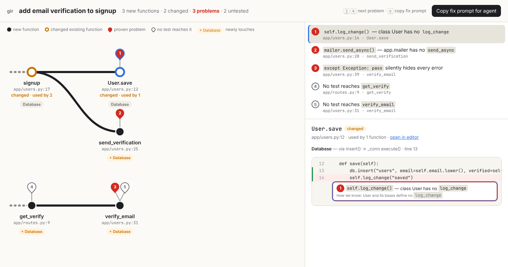

# gir

**Review AI-written code in seconds, not diffs.**

When your coding agent finishes, gir turns its change into a **behavior map** instead of a text diff. Each group of changed functions becomes one line read left to right in call order. Changed existing code shows up in amber, and new side effects (database, network, files, commands, global state) are labeled. Proven problems are red pins on the function where they occur. Click a pin to jump to the exact line along with the evidence for it. One key copies a fix prompt for the agent.



## What it catches

Every red pin is *proven* by static analysis and never guessed. Anything gir can't determine stays silent, so it doesn't raise false alarms.

| Pin | Example | How it's proven |
|---|---|---|
| Hallucinated call | `mailer.send_async()` when `mailer` has no `send_async` | Project index plus a real import of installed packages |
| Hallucinated method | `self.log_change()` on a class that doesn't define it | Class and base-class members (skipped when the class is dynamic) |
| Hallucinated import | `from app.utils import slugify_v2` | Same as above |
| Undefined name | `undefined_helper()` | Not defined, imported or built in anywhere in scope |
| Swallowed error | `except Exception: pass` | Broad except whose body does nothing |
| Syntax error | the file doesn't parse | Python's parser |
| Untested *(grey pin)* | `verify_email` | No test reaches it, directly or through other functions |

It also shows:
- **Side effects**, traced through your own functions. For example, `get_verify` writes to the database *via* `verify_email()` → `db.query()`. Effects the function didn't have before the change are marked **+ new**.
- **Blast radius**: a changed existing function shows how many functions call it.
- **What's hidden**: formatting- or docstring-only changes, test changes and removed functions are listed below the map rather than drawn.

## Install

```bash
pip install git+https://github.com/sh1v-ansh/graph-ir
```

Requires Python 3.10+ and has no dependencies.

## Use

```bash
gir                                  # map uncommitted changes vs HEAD, open in browser
gir --task "add email verification"  # title the map with what you asked for
gir --base main                      # everything on this branch vs main
gir prompt                           # print the fix prompt for your agent
```

`gir` exits with `1` when there are proven problems, so you can use it in CI or a pre-commit hook.

The map is written to `.gir/map.html`, which gir adds to `.git/info/exclude` so it never shows up in `git status`.

## Make it automatic with Claude Code

Add this to `.claude/settings.json` in your project, or to `~/.claude/settings.json`:

```json
{
  "hooks": {
    "Stop": [{ "hooks": [{ "type": "command", "command": "gir hook" }] }]
  }
}
```

When the agent finishes:
1. **If gir finds proven problems**, it blocks the stop and hands the agent the fix prompt. The agent fixes its own hallucinated calls and swallowed errors before you ever look.
2. **Once it's clean**, gir opens the map, titled with your last request, so you review a short, already-checked change.

Settings: `GIR_OPEN=0` stops the map from opening automatically, and `GIR_BASE=main` compares against a branch instead of `HEAD`.

## Try the demo

```bash
python examples/make_demo.py /tmp/gir-demo
cd /tmp/gir-demo && gir --task "add email verification to signup"
```

## Limits (v0.1)

- Python only.
- "Did what you asked" vs "did something you didn't ask for" isn't implemented yet. Today the map shows *what* changed and *where it's broken*, not whether it matches your intent.
- Instance method calls on unknown objects (`client.foo()`) aren't checked, because gir can't prove what `client` is.

## Development

```bash
pip install -e ".[dev]"
pytest
```
